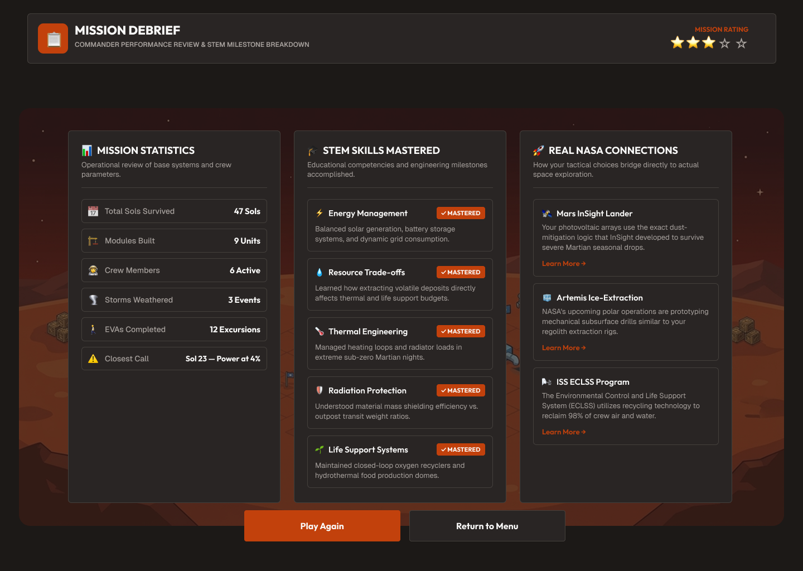

# 🚀 Mars Horizon — Junior Astronaut Mission Trainer

<p align="center">
  
</p>

[](https://github.com/Theteamakrasia/Mars-Horizon-Junior-Astronaut-Mission-Trainer/actions/workflows/ci.yml)
[](https://github.com/Theteamakrasia/Mars-Horizon-Junior-Astronaut-Mission-Trainer/actions/workflows/deploy.yml)
[](https://www.typescriptlang.org/)
[](https://vite.dev/)
[](https://vitest.dev/)
[](LICENSE)

**A space-survival strategy game where kids learn to run a real Martian outpost.**

You are a newly chosen junior astronaut. You have been trained for months, but you have
never actually *been* anywhere. Your rocket has arrived at Mars, and from here on out,
every decision is yours.


Where do you land? How much power do you build? Do you spend your water on the crew or
save it for the greenhouse? When a dust storm is three sols away, what do you fix first?

**There are no enemies. The hardest thing you'll fight is a resource budget.**

| | |
| --- | --- |
| 🏆 **Event** | [2026 NASA Space Apps Challenge](https://www.spaceappschallenge.org/) — November 14–15, 2026 |
| 📚 **Subjects** | Space Exploration, Games, Planets & Moons, Software, The Sun |
| 🎯 **Difficulty** | Beginner / Youth · Intermediate |
| 👦 **Audience** | Ages ~8–16, families, classrooms |
| 🛠 **Status** | Playable prototype — all nine journey screens built |

> **Attribution.** This project is a student entry in the 2026 NASA Space Apps Challenge.
> It is **not** produced, endorsed, or operated by NASA. NASA, the NASA insignia, and the
> Space Apps Challenge name are trademarks of the National Aeronautics and Space Administration,
> used here only to identify the challenge this project responds to and to credit NASA as
> the source of the open data it is built on.

---

## Index

- [What Is This Game?](#what-is-this-game)
  - [The Design Promise](#the-design-promise)
- [The Challenge We're Answering](#the-challenge-were-answering)
- [Your Mission](#your-mission)
  - [The Journey, Screen by Screen](#the-journey-screen-by-screen)
  - [The Ten Missions](#the-ten-missions)
- [Gameplay Walkthrough](#gameplay-walkthrough)
  - [Name Your Astronaut](#name-your-astronaut)
  - [Mission Briefing](#mission-briefing)
  - [Supply Check — The Ration Gate](#supply-check--the-ration-gate)
  - [Launch and Spacecraft Tour](#launch-and-spacecraft-tour)
  - [Spacecraft Interior](#spacecraft-interior)
  - [Choose Your Landing Site](#choose-your-landing-site)
  - [Establish Your Base](#establish-your-base)
  - [Run the Sols](#run-the-sols)
  - [Debrief — Learn From What Happened](#debrief-learn-from-what-happened)
- [What You Learn](#what-you-learn)
  - [The Science Is Real](#the-science-is-real)
  - [On the International Space Station](#on-the-international-space-station)
- [Why This Matters for Earth](#why-this-matters-for-earth)
- [NASA Data Sources](#nasa-data-sources)
- [Kid-Friendly by Design](#kid-friendly-by-design)
- [Project Status](#project-status)
- [Setup and Running](#setup-and-running)
- [Project Structure](#project-structure)
- [Documentation](#documentation)
- [Game Flow and Decisions](docs/game-flow.md)
- [Screenshot Index](#screenshot-index)
- [Keep Exploring](#keep-exploring)

---

<a id="what-is-this-game"></a>
## 🎮 What Is This Game?

**Mars Horizon** is an interactive simulation where you manage a small research outpost on
the surface of Mars. Instead of fighting monsters or collecting coins, you balance
competing demands — the exact same kind of trade-offs real NASA engineers face every day.

You manage five things that never stop draining:

| Resource | Why It Runs Out |
| --- | --- |
| ⚡ **Power** | Your solar panels only work in daylight. Night is coming. |
| 🫁 **Oxygen (O₂)** | You breathe it out and it never comes back on its own. |
| 💧 **Water** | You need it to drink, to grow food, and to make more water. |
| 🍞 **Food** | Growing it takes water, power, and time. |
| 🛡️ **Radiation Shielding** | Mars has no global magnetic field to protect you. |

Every choice you make improves one of those and costs you another. That's the whole game —
and it's also the whole job.

<a id="the-design-promise"></a>
### The Design Promise

Most space games fall into one of two traps:

- ❌ **Too simple.** "Collect the shiny rocks, build the base, win." No real thinking required.
- ❌ **Too complicated.** A wall of engineering jargon and 400 buttons that turns a kid off.

Mars Horizon aims for the narrow path between them: **scientifically honest, but built so a
child can understand it without a manual.** No violence, no fantasy creatures, no magic.
Just engineering — the real kind, made playable.

---

<a id="the-challenge-were-answering"></a>
## 🧩 The Challenge We're Answering

The 2026 Space Apps brief identifies a real gap:

> Space-themed STEM content often oversimplifies the engineering trade-offs that define a
> real mission, or presents them at a level too complex to hold a young learner's attention.
> Few tools make those trade-offs both tangible and fun.

Your challenge is to design and build an interactive game or app that lets students run a
lunar or Martian outpost — balancing competing demands like life support, radiation
shielding, power, and food production — so they experience firsthand the decisions that
determine whether a mission fails or succeeds.

**Our answer:** a survival-strategy loop where the trade-offs *are* the gameplay. You cannot
win by hoarding one resource, because every action you take is paid for in another. Players
who succeed do it by thinking like engineers — building margin before they need it.

---

<a id="your-mission"></a>
## 🗺 Your Mission

<a id="the-journey-screen-by-screen"></a>
### The Journey, Screen by Screen

From rocket touchdown to a self-sustaining outpost, the game follows one clear arc. Every
step below is a real screen you can reach, in this order:

```
🚀 NAMING                     → name your astronaut (the main menu)
      ↓
📋 BRIEFING                   → why we go, and the five resources
      ↓
🍱 SUPPLY CHECK               → the ration maths gate
      ↓
🎬 LAUNCH + SPACECRAFT TOUR   → the film, then the parts tour
      ↓
🚪 INTERIOR                   → walk all six rooms of the transit habitat
      ↓
🗺  LANDING SITE              → pick one of five regions
      ↓
🏠 BASE                       → spend 14 build points on modules
      ↓
🔄 SOL LOOP (`act`)           → run sols 1-12, answer the crises
      ↓
📝 DEBRIEF                    → what worked, what didn't, and why
```

The route table lives in [`src/ui/routes.ts`](src/ui/routes.ts); the journey and every gate
are drawn in [`docs/game-flow.md`](docs/game-flow.md).

<a id="the-ten-missions"></a>
### The Ten Missions

The design has a ten-mission arc. **The prototype implements the survival loop, not ten
separate missions:** you build an outpost, run twelve sols, and meet four scheduled events.
The missions below are the shape the loop is meant to grow into.

| # | Mission | What you're learning |
| --- | --- | --- |
| 1 | **Establish Outpost** | Basic infrastructure and why nothing works without power |
| 2 | **Survey Environment** | Reading real site data before you commit to it |
| 3 | **Robotic Operations** | Why rovers are safer and cheaper than people for routine jobs |
| 4 | **First EVA** | Spacewalks: suit limits, airlock cycles, and time pressure |
| 5 | **Find Resources** | Locating what you need instead of shipping it from Earth |
| 6 | **ISRU** *(In-Situ Resource Utilization)* | Turning local dirt and ice into usable supplies |
| 7 | **First Harvest** | Closing the loop — food you grow is food you don't launch |
| 8 | **Science Expedition** | Why research is the entire point of the mission |
| 9 | **Survive Major Hazard** | A real dust storm. Everything you prepared for gets tested. |
| 10 | **Expand the Outpost** | Growth without losing stability |

> **ISRU** is the big one for curious players. It stands for *In-Situ Resource Utilization* —
> using materials found where you are instead of shipping them from Earth. On a real Mars
> mission, this is the difference between a base that can survive and one that eventually
> runs dry. It's also the whole reason scientists hunt for water ice under the Martian surface.

---

<a id="gameplay-walkthrough"></a>
## 🎬 Gameplay Walkthrough

The images below are the UI design mockups the screens were built from, in the order you
meet the screens. Where a mockup and the build differ, the build wins — the differences are
called out. The whole flow is one route chain:
`naming → briefing → supply → launch → interior → landing-site → base → act → debrief`.

<a id="name-your-astronaut"></a>
### 1. Name Your Astronaut

`#/naming` is both the entry screen and the main menu. The greeting updates as you type, the
name is capped at 24 characters, and **Start Mission** stays disabled until the name contains
something that is not whitespace. The name is stored in the run, and later screens use it.

There is no login in front of this screen and no save behind it: the run lives in memory only
and is lost on refresh (D-003).

<a id="mission-briefing"></a>
### 2. Mission Briefing

`#/briefing` explains why the mission goes to Mars and what the five resources are. The
astronaut-between-Earth-and-Mars artwork is shown **whole**, locked to its own shape as the
backdrop (the supply screen does the same with its stage), and the briefing is spoken **one
line at a time over it**: **NEXT** (or the **Enter** key) swaps in the next line, each one
replacing the last. The closing line brings up **YES!!**, and the screen hands you on by
itself if nobody presses it. There is no skip and no CONTINUE, because the briefing is not
optional.

<a id="supply-check--the-ration-gate"></a>
### 3. Supply Check — The Ration Gate

`#/supply` is a hard gate: a ration maths question — two months, four crew, three days per
packet. The correct answer reveals **CONTINUE**. A wrong answer asks you to try again instead
of ending the attempt (ISS-034, ISS-035). Nothing from this screen is stored in the run.

<a id="launch-and-spacecraft-tour"></a>
### 4. Launch and Spacecraft Tour

`#/launch` plays the launch film, then a spacecraft parts tour. The tour is a full-viewport
panel rather than part of the letterboxed 16:9 stage, so its name, image, description and
three controls cannot be clipped on a short window (D-036). **Continue** is the only exit.

<a id="spacecraft-interior"></a>
### 5. Spacecraft Interior

`#/interior` is a walkable tour of the transit habitat: cabin, galley, lab, sleep, logistics
and safe haven. You move with the arrow keys (or the on-screen pad), press **N** for the next
room and **R** to hear a brief again. The landing-site screen unlocks only once every room has
been visited.

<a id="choose-your-landing-site"></a>
### 6. Choose Your Landing Site

Your rocket is in orbit. Five regions are marked on the map — and **there is no perfect
choice.** Each one is strong in some ways and dangerous in others.


The **Site Analysis** panel scores the region you have selected across five axes, out of 5 each:

| Axis | What it means for you |
| --- | --- |
| 💧 **Water** | Is there ice nearby? Can you make your own? |
| ☀️ **Sun** | How much power will your solar panels actually get? |
| ⛰️ **Terrain** | Flat and safe, or steep and hard to build on? |
| 🌪️ **Dust** | Will storms bury your equipment? |
| 🌡️ **Temp** | How much energy will you burn just staying warm? |

Select a pin and press **Land here** to commit; the choice sets your starting stores and the
site rules that apply to the build screen.

**The lesson:** a site with perfect water and terrible sun will kill you just as surely as
one with great sun and no water. Real landing-site selection is exactly this — NASA picked
Jezero Crater not because it's the *best* place, but because its combination of ancient
river deposits and workable terrain makes it the most **interesting** place to explore.

<a id="establish-your-base"></a>
### 7. Establish Your Base

`#/base` is the outpost. The habitat and life support are core modules; on top of them you
spend **14 build points** across eight module kinds — solar arrays, battery banks, a nuclear
unit, a greenhouse, an ice miner and regolith shielding — subject to slot limits and two hard
site rules (the ice miner needs water ≥ 3; the regolith shield needs terrain ≥ 2). You are
allowed to launch with nothing extra. That is a choice, and usually a bad one.


The run's clock is fixed before you land: a flare on sol 3, a supply pod on sol 5, a dust
storm on sol 7 and a second flare on sol 10 (D-033). The mockup above shows an earlier,
illustrative forecast; the build uses that four-event schedule. This screen is where you
prepare for it. Press **Land & start sol 1** when you are ready.

<a id="run-the-sols"></a>
### 8. Run the Sols

`#/act` advances exactly one sol per press of **Run sol N**. Nothing in the outpost is on a
timer: the game waits for you. Each sol resolves in the same order — cargo arrives, the Sun
comes up, the night drains the batteries, and whatever power cannot be found slows life
support and the greenhouse.

When an event is due, the crisis panel replaces the mission panel inside the same screen shell
(D-040). A flare or a storm gives you ten seconds and one of three choices; the supply pod
does not. If the countdown runs out, the default option is applied and recorded as timed out,
so the debrief can say exactly what that cost.


The mockup is the power trade-off the loop is built around:

> ☀️ Sun → 📡 Arrays → **+45 kW/h** → 🔋 Storing 12 kW/h → 🌙 **−30 kW/h night drain**

Its numbers are illustrative. In the build, one array makes 25 kW while the Sun is up, scaled
by the site's sun score, panel health and the storm factor; one battery bank stores 100 kWh;
the nuclear unit makes 10 kW day and night. Night is 12 hours, and the panels make nothing
during it. You can have excellent sunlight and still lose, because the power you collect by
day has to survive the night *and* run the habitat, life support and greenhouse.

That's not a made-up puzzle. It's the exact reason NASA's rovers and habitats rely heavily
on **nuclear power** rather than solar alone. The trade-off is real, and the game makes a
child feel it.

<a id="debrief-learn-from-what-happened"></a>
### 9. Debrief — Learn From What Happened

You win by reaching **sol 12** with every life store — oxygen, water, food, shielding — above
zero. You lose the moment any one of them hits zero. Both endings route here; there is no
third state and no separate "Final" screen (D-035).



The debrief is where the learning actually lands. It reviews every crisis choice as **solved**,
**mixed** or **caught**, and shows the per-sol ledger:

- What you **used** and what you **wasted**
- Which problems you solved early and which ones caught you
- The **real science** behind whatever went wrong

**View my Mars story** opens the journal mode of the same screen (D-039); **Try a different
outpost** and **Main menu** leave the run. A run that ends badly is the most educational run
in the game.

<a id="what-you-learn"></a>
## 🎓 What You Learn

Playing Mars Horizon is really a systems-thinking lesson wearing a spacesuit. Here's what
a player takes away without ever being told a lesson:

| Skill | How the game teaches it |
| --- | --- |
| **Trade-off thinking** | No action is free. Every fix costs a different resource, so there's never one right answer |
| **Systems thinking** | Changing one thing ripples through everything else — more modules means more power draw *and* more oxygen to recycle |
| **Energy balance** | Day/night cycles, storage capacity, and the gap between generating and surviving until sunrise |
| **Closed-loop living** | Recycling water, regenerating air, and growing food instead of resupplying — the core of real off-world life support |
| **Reading data** | Storm warnings, resource stores and the fixed forecast are how you make decisions, not decoration |
| **Preparation & margin** | Winners build reserves *before* the crisis. This is a life skill, not just a game one |
| **Reading real space-weather data** | Solar-flare strength comes from live NASA data, with NOAA as a backup, not made-up numbers |
| **Second attempts** | Losing teaches more than winning, because the debrief explains exactly *why* |

<a id="the-science-is-real"></a>
### The Science Is Real

We don't invent numbers when we don't have to. A few things the game models, straight from
NASA:

- **A day on Mars is called a *sol***, and it's about **39 minutes and 35 seconds longer** than
  an Earth day. Every schedule in the game is counted in sols for this reason.
- **Mars has no global magnetic field today.** Earth's field deflects charged particles from
  the Sun; Mars has nothing, which is why radiation shielding is a permanent, ongoing cost.
  (Ironically, leftover traces of an ancient magnetic field *are* preserved in Mars's
  southern crust — one of the planet's most interesting puzzles.)
- **The Martian atmosphere is mostly carbon dioxide**, with nitrogen and argon making up the
  rest, and it's so thin that heat escapes easily. Surface temperatures swing from about
  **−153 °C to 20 °C**. That thin air is also why the sky looks red — it's suspended dust,
  not a blue sky like ours.
- **Water exists on Mars today**, but not as liquid. It's locked as ice beneath the polar
  surface, plus salty brines that flow seasonally down hillsides. Finding and using it is the
  whole game.
- **Space storms are real and tracked.** Solar flares and coronal mass ejections are monitored
  by NASA every day — that's what DONKI does.

<a id="on-the-international-space-station"></a>
### On the International Space Station

The systems in this game aren't sci-fi. The ISS has been quietly proving them out for
decades. NASA's **Environmental Control and Life Support System (ECLSS)** does exactly what
our game asks you to simulate: it controls air pressure, oxygen levels, ventilation, waste
management and water supply. It has three main parts:

- **Water Recovery System** — cleans wastewater, humidity and even water from spacesuits,
  currently recycling roughly **90% of the water on station**
- **Air Revitalization System** — scrubs carbon dioxide and other trace contaminants out of
  the air you breathe
- **Oxygen Generation System** — splits water into oxygen and hydrogen by electrolysis

Astronauts are, on a small scale, playing our game every single day. The difference is NASA
gets to cheat with resupply ships. On Mars, you can't.

---

<a id="why-this-matters-for-earth"></a>
## 🌍 Why This Matters for Earth

It's easy to think of a Mars outpost game as pure entertainment. It isn't. The exact
engineering skills it teaches are the ones we're going to need long before anyone sets foot
on Mars.

**We're already running out of things to take for granted.** Fresh water, clean air, and
reliable power are becoming the defining global challenges of this century — and the
"closed-loop living" mechanic in this game is a simplified model of exactly the closed-loop
systems environmental engineers are trying to build *here*. Learning to waste less is a
planetary-scale habit, and Mars is a good place to practise it.

**Climate and space weather share a root cause.** The same solar activity that drives the
coronal mass ejections behind our game's storm warnings also drives the auroras on Earth — and
can disrupt satellites, GPS, radio and power grids. Understanding that the Sun matters to
both planets is a genuinely important idea.

**Perseverance proved we can look for ancient life.** NASA's Mars 2020 rover landed in Jezero
Crater — one of the landing sites in our game — specifically because it's an ancient river
delta that may have once held liquid water and, possibly, life. The science in this game is
the science a real rover is doing right now.

**And the goal is bigger than Mars.** Everything built toward a self-sustaining outpost —
recycling systems, closed-loop food, renewable power, living efficiently on a small
budget — is technology we need on Earth first. Mars is a forcing function that makes us
solve problems we have to solve anyway.

**That is the real goal of a Mars mission**, and it is the hardest engineering problem
humans have ever attempted.

---

<a id="nasa-data-sources"></a>
## 🛰️ NASA Data Sources

Every technical value in this project is grounded in real, publicly available NASA
resources. These are the ones we build on:

| Source | What it gives us |
| --- | --- |
| **[NASA Space Apps Challenge](https://www.spaceappschallenge.org/)** | The challenge brief this project answers. 2026 event: November 14–15, 2026 |
| **[Mars: Facts](https://science.nasa.gov/mars/facts/)** | Atmosphere composition, temperature range, water, and the absence of a global magnetic field |
| **[Telling Time on Mars](https://www.giss.nasa.gov/research/briefs/1998_allison_02/)** (GISS) | Sol length — 24 h 39 m 35.2 s — and why sols are the unit of a Martian schedule |
| **[ECLSS](https://www.nasa.gov/reference/environmental-control-and-life-support-systems-eclss/)** | How real life support works: water recovery (~90% reuse), air revitalization, oxygen generation |
| **[Life Support BVAD](https://ntrs.nasa.gov/citations/20210024855)** *(Baseline Values and Assumptions Document)* | Standard reference values for human life-support needs — the basis for our resource numbers |
| **[DONKI](https://ccmc.gsfc.nasa.gov/tools/DONKI/)** | The Space Weather database tracking solar flares and coronal mass ejections — our in-game storms |
| **[Planetary Data System (PDS)](https://pds.nasa.gov/)** | NASA's long-term archive of planetary mission data, including Mars observations |
| **[NASA Open Data Portal](https://data.nasa.gov/)** | NASA's public catalog of open datasets across science and exploration |
| **[NASA API Portal](https://api.nasa.gov/)** | Direct access to NASA APIs for live data, including imagery and space weather |
| **[NASA Space Place](https://spaceplace.nasa.gov/)** | NASA's kid-facing science site — our reference for tone, reading level and age-appropriateness |

**A note on honesty:** where we don't have a hard number, we tell the player it's an
approximation. Faking precision would teach kids to trust data that isn't real, which is the
exact opposite of what this game is for.

Live flare strength is read from DONKI through the NASA API portal. When NASA is
unavailable, the game falls through to NOAA's Space Weather Prediction Center, and if
neither answers it uses famous past flares — always labelled approximate. The forecast's
timing is part of the game design and is not taken from either feed.

---

<a id="kid-friendly-by-design"></a>
## 👦 Kid-Friendly by Design

This game is built for young players first, and every decision follows from that:

- **No violence.** Nothing shoots at you. Failures cost resources and time, never a life.
- **No fantasy elements.** No aliens, no magic, no monsters. The only enemy is physics.
- **Realistic, but readable.** The science is true; the presentation is a friendly UI with
  emoji markers, plain language and no unexplained jargon.
- **No punishing complexity.** A child can land, survive several sols and understand *why*
  they made the choices they did — without reading a manual.
- **Losing is informative.** There's no game-over screen that just says "you failed." You get a
  debrief explaining the real cause, which is the point.
- **A gentle difficulty curve.** The journey teaches one idea at a time — the resources, then
  the site, then the build, then the sol loop. Complexity is added only as the player is ready.

---

<a id="project-status"></a>
## 🛠 Project Status

**Mars Horizon is a playable prototype.** The whole journey is built and playable in the
browser: `naming → briefing → supply → launch → interior → landing-site → base → act →
debrief`. A run starts when the player names their astronaut and ends at the debrief with a
win (reaching sol 12) or a loss (any life store hits zero). The run lives in memory; there is
no save.

Release and deployment updates are tracked in the [changelog](docs/CHANGELOG.md). Every
player decision, the sol loop, what is built and where a new event plugs in are mapped in
[`docs/game-flow.md`](docs/game-flow.md).

| Area | State |
| --- | --- |
| The nine-screen journey | **Built** and routed |
| Resource simulation and sol loop | **Built** — 12 sols, four scheduled events |
| Crisis decisions and debrief verdicts | **Built** — flare, storm and supply pod |
| Live flare strength | **Built** — NASA DONKI → NOAA SWPC → baked fallback |
| Tests | **492 tests in 22 files** (`npm test`, 2026-11-11) |
| Checks | **Clean** — import layers, banned APIs, markup, strict typecheck |
| Save / resume | **Not built** — in-memory only (D-003) |
| Login before `naming` | **Not built** — Supabase deferred (D-003, TASK-022) |
| Plan phase | **Deliberately not built** — do not add unasked (D-029) |
| New forecast event kinds | **Not built** — extension steps in `docs/game-flow.md` |

### Tech stack

- **TypeScript 5.9**, `strict` and `noUnusedLocals`; `npm run check` must pass.
- **Vite 7** for the dev server and the production build; **Vitest 3** for the tests.
- **Vanilla DOM.** No framework, no state library, **zero runtime dependencies**. Adding one
  is an architecture change, not a convenience.
- **Plain CSS**, one stylesheet per feature, imported by that feature's own `view.ts`.
- **Node 22**, which is what CI runs.

### The one invariant

`sim/` and each feature's `model.ts` are pure: no `document`, no `window`, no network. That
is what lets 492 tests run in a few seconds with no browser and no mocks. It is enforced by
`npm run check` (`scripts/check-imports.mjs`), not left to good intentions.

---

<a id="setup-and-running"></a>
## ⚙️ Setup and Running

```bash
npm install       # dev dependencies only — the game ships no runtime dependencies
npm run dev       # Vite dev server, http://localhost:5173
npm run check     # import-layer + banned-API + markup checks, then tsc --noEmit
npm test          # Vitest, 492 tests in 22 files
npm run build     # production bundle in dist/
npm run preview   # serve the built bundle locally
```

Open the dev server and the default route is `#/naming`, the entry screen. Every screen has a
hash of its own (`#/base`, `#/act`, `#/debrief`, …), but a run should start at `naming`.
`?motion=force` and `?motion=reduce` override the OS reduced-motion setting for the landing
page.

There is nothing to configure and no API key to provide. Space weather uses the public
`DEMO_KEY` path and falls through on its own (ISS-009).

### Placing the outpost modules

Where each module stands on the Mars panel is **data, not code**: it lives in
[`src/ui/baseLayout.json`](src/ui/baseLayout.json). To change it, drag the modules on the
real screen rather than editing the numbers:

```
npm run dev
open http://localhost:5173/?editlayout=1#/base
```

Every copy of every module is on the panel at once — four solar arrays, four battery
banks, two regolith shields and one of everything else. Drag one to move it; drag the
orange grip on its corner to resize it; press **F** or use the **⇄ Mirror** button to
turn it around. The toolbar shows the selected module's numbers, the JSON the editor
would write, and buttons to download it, copy it, reset, or leave. Copies overlap, so
the dropdown is how you pick the one underneath.

Save the downloaded `baseLayout.json` into `src/ui/` and the game uses it. The file holds
a pose list per kind — the nth entry is where the nth copy of that kind stands — so the
same layout is used on the build, sol and debrief screens, and every copy the player
builds lands where you put it. A pose may also be `flip`ped, which turns the artwork
around without moving it.

This is a developer tool. It only exists in a dev build and is compiled out of a
production bundle, so a player can never reach it.

---

<a id="project-structure"></a>
## 📁 Project Structure

```text
Mars-Horizon-Junior-Astronaut-Mission-Trainer/
├── README.md                    ← this file
├── AGENTS.md                    ← working rules, enforced checks, doc-update matrix
├── index.html                   ← page shell and every screen mount point
├── package.json                 ← scripts; devDependencies only
├── tsconfig.json · vite.config.ts · vercel.json
├── GAME_LOOP_PLAN.md            ← gameplay design plan
├── Landing_site_selection_implementation_plan.md
├── .github/workflows/           ← ci.yml (checks) and deploy.yml (Vercel)
├── Assets/
│   ├── images/                  ← landing page, screens, interior sprites
│   ├── video/                   ← launch, docking and parts clips
│   └── README_ref/              ← the design mockups linked in this document
├── scripts/
│   ├── check-imports.mjs        ← layering and banned-API checks
│   └── check-markup.mjs         ← mount-point and hook-scoping checks
├── docs/                        ← architecture, game flow, changelog, team records
└── src/
    ├── main.ts                  ← boot, element lookup, screen mounting
    ├── style.css                ← landing-page stylesheet entry
    ├── sim/                     ← pure rules: no DOM, no network
    │   ├── resources.ts         ← drain and stores
    │   ├── sol.ts               ← advance one sol, win/lose
    │   ├── run.ts               ← RunState and progression
    │   ├── modules.ts           ← catalogue, costs, upkeep, every tuning number
    │   ├── regions.ts           ← the five landing regions
    │   ├── forecast.ts          ← the fixed event schedule
    │   ├── crises.ts            ← crisis copy, options, defaults
    │   └── comms.ts             ← Earth–Mars delay
    ├── data/
    │   └── spaceweather.ts      ← NASA DONKI → NOAA SWPC → baked fallback
    ├── dom/                     ← landing page and browser glue
    │   ├── floatAstronaut.ts · pointerGrab.ts · starfield.ts
    │   ├── forecastLoader.ts    ← joins live flares to the forecast
    │   └── h.ts                 ← element helper
    ├── ui/
    │   ├── routes.ts · router.ts ← hash routing and the journey order
    │   ├── registry.ts          ← route → screen; the only file importing a view
    │   ├── gameLoop.ts          ← shared outpost screen shell
    │   ├── baseLayout.json      ← where each module stands on the Mars panel
    │   ├── baseLayout.ts        ← loads and validates that layout
    │   ├── baseLayoutEditor.ts  ← the ?editlayout=1 placement editor (dev only)
    │   └── button-strip.ts · button-strip.css
    ├── features/                ← one folder per screen
    │   ├── naming/ · briefing/ · supply/
    │   ├── launch/ · interior/ · landing-site/
    │   ├── base/ · act/ · debrief/
    │   └── README.md            ← the four-files-per-feature contract
    └── styles/                  ← landing page: base, astronaut, message, starfield, game-loop
```

Every feature folder is built from the same four files: `model.ts` (pure rules),
`model.test.ts`, `view.ts` (DOM only) and `<name>.css`. A feature may also carry a
`README.md` describing its screen. Depth never exceeds two levels.

---

<a id="documentation"></a>
## 📚 Documentation

The rules are in `AGENTS.md`; the reasoning is in `docs/`. Start with these:

| Document | What it answers |
| --- | --- |
| [`AGENTS.md`](AGENTS.md) | Working rules, the enforced checks, the doc-update matrix, what is out of scope |
| [`docs/architecture.md`](docs/architecture.md) | Annotated file tree, layering, module contracts, known simplifications |
| [`docs/game-flow.md`](docs/game-flow.md) | Every player decision, the sol loop, what is built, how to add an event |
| [`docs/team/decisions.md`](docs/team/decisions.md) | Why things are the way they are, including what was rejected |
| [`docs/team/issues.md`](docs/team/issues.md) | Every known problem, its severity and status |
| [`docs/team/goals.md`](docs/team/goals.md) | What "done" means for this project |
| [`docs/team/tasks.md`](docs/team/tasks.md) | Who owns what, and what is finished |
| [`docs/team/progress-log.md`](docs/team/progress-log.md) | What happened last and what went wrong |
| [`docs/CHANGELOG.md`](docs/CHANGELOG.md) | User-visible and deployment changes |
| [`docs/codebase/`](docs/codebase/) | Stack, structure, conventions, testing, integrations, concerns |
| [`docs/pull-requests/`](docs/pull-requests/) | Written records for the CI, deployment and retry pull requests |

Each screen also has a `README.md` inside its feature folder describing what that screen is
meant to contain. New contributors should read `AGENTS.md` first and
[`docs/game-flow.md`](docs/game-flow.md) second.

---

<a id="screenshot-index"></a>
## 🖼 Screenshot Index

These are **design mockups**, not screen captures; the notes column says where each one is
used. The retired plan-phase and "Final" mockups are kept in `Assets/README_ref/` for
history, but neither screen exists in the build (D-029, D-035).

| # | Screen | File | Shown in |
| --- | --- | --- | --- |
| 1 | Landing site selection | [`Assets/README_ref/choose landing.png`](Assets/README_ref/choose%20landing.png) | Walkthrough step 6 |
| 2 | Outpost overview | [`Assets/README_ref/survival loop.png`](Assets/README_ref/survival%20loop.png) | Walkthrough step 7 |
| 3 | Power trade-off (act) | [`Assets/README_ref/survival loop-2.png`](Assets/README_ref/survival%20loop-2.png) | Walkthrough step 8 |
| 4 | Debrief | [`Assets/README_ref/debrief.png`](Assets/README_ref/debrief.png) | Walkthrough step 9 |
| — | Plan phase *(retired mockup)* | [`Assets/README_ref/survival loop-1.png`](Assets/README_ref/survival%20loop-1.png) | Not in the build — D-029 |
| — | Final *(retired mockup)* | [`Assets/README_ref/Final.png`](Assets/README_ref/Final.png) | Not in the build — D-035 |

---

<a id="keep-exploring"></a>
## 🪐 Keep Exploring

If this game sparks your curiosity, these are genuinely good places to keep going — all
official NASA, all free:

- 🔬 **[NASA Space Place](https://spaceplace.nasa.gov/)** — games, crafts and articles made for kids
- 🚀 **[Mars Exploration](https://science.nasa.gov/mars/)** — the missions, rovers and the real science
- 👨‍🚀 **[NASA Humans in Space](https://www.nasa.gov/humans-in-space/)** — what crews actually do in orbit
- 📅 **[Space Weather](https://www.nasa.gov/space-weather/)** — the storms that power our in-game warnings

---

*Built with curiosity, for curious kids. Good luck out there, astronaut. 🚀*

---
