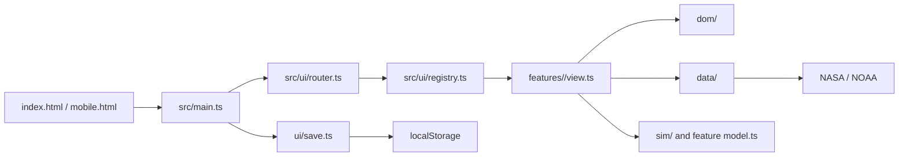

# Architecture

This document describes the implementation currently in the repository. Product
decisions and detailed sol mechanics are recorded in [`game-flow.md`](game-flow.md) and
[`team/decisions.md`](team/decisions.md). Repository-wide coding constraints are in
[`../AGENTS.md`](../AGENTS.md).

## System overview

Mars Horizon is a static, client-side TypeScript application. Vite compiles two HTML
entrypoints (`index.html` and `mobile.html`) into `dist/`; no application server or
database is required. `src/main.ts` composes the browser runtime, loads the device-local
save, and starts hash-based routing. The current journey is
`naming → briefing → supply → launch → interior → landing-site → base → act → debrief`.

## Boundaries and invariants

The import checker in `scripts/check-imports.mjs` enforces the dependency direction below.
`RunState` is passed through the application shell when screens need shared mission state;
feature folders remain independent.

| Area | Responsibility | Constraints |
| --- | --- | --- |
| `src/sim/` | Simulation rules, state transitions, catalogs, and pure training mechanics | Imports only from `sim/`; no browser APIs or network |
| `src/features/<screen>/model.ts` | Screen-specific derivation and presentation data | Pure; no DOM, network, or imports from another feature |
| `src/features/<screen>/view.ts` | Screen rendering and interactions | Uses shared `RunState` and `setRun`; may call allowed `dom/`, `data/`, `sim/`, and `ui/` modules |
| `src/data/` | External NASA/NOAA requests and saved catalogues | Imports only `data/` and `sim/` |
| `src/dom/` | Browser effects and bridges between views and data/simulation | Imports only `dom/`, `data/`, and `sim/` |
| `src/ui/` | Router, registry, shared controls, persistence, audio, and icons | Only `ui/registry.ts` imports feature views |
| `src/main.ts` | Composition root and lifecycle coordination | Loads save before the first route mount |

Pure logic is colocated with tests. Views own DOM effects; data clients own network
requests. This separation makes most game behavior testable in Node without DOM mocks.

## Startup and navigation

1. The browser loads `index.html`; coarse-pointer phone layouts are redirected to
   `mobile.html`, which frames the same game at its 16:9 design size.
2. Vite loads `src/main.ts` and the global stylesheet. The main module resolves required
   landing-page elements, initializes the starfield and astronaut effects, and preloads
   landing frames.
3. `ui/save.ts` restores the versioned run from `localStorage` before routing starts.
4. `ui/router.ts` reads `location.hash` and asks `ui/registry.ts` for the screen factory.
   The active screen is unmounted before the next one is mounted.
5. Screen callbacks update the run through the shell; the save follows it on the current
   device. Data loaders can enrich screens asynchronously without placing network logic
   in simulation models.

## External data and persistence

- `data/spaceweather.ts` requests solar flare data from NASA DONKI, falls back to NOAA
  SWPC, then returns no live events so `sim/forecast.ts` can use approximate seeded
  events. The forecast schedule is generated locally per run.
- `data/nasaDaily.ts` requests NASA Astronomy Picture of the Day and falls back to the
  saved gallery in `data/nasaGallery.ts`.
- `ui/save.ts` is the only localStorage adapter. The serialized/versioned format is in
  `sim/save.ts`; saves do not sync across browsers or devices.
- `index.html` requests Google Fonts. The app remains usable without that request, with
  fallback fonts.

No backend, database, account system, analytics, or telemetry integration is configured.

## Build and verification

`vite.config.ts` disables Vite's default `public/` directory, uses a relative asset base,
and builds both HTML entrypoints into `dist/`. `npm run check` runs the import boundary
and markup checks followed by TypeScript. `npm test` runs Vitest. `npm run balance` checks
that the simulation remains winnable over legal builds, sites, and forecast seeds.
`tools/browser-check-*.mjs` scripts exercise selected flows in a real browser when the
required local browser tooling is available.

## Evidence

- `index.html`, `mobile.html`, `src/main.ts`
- `src/ui/router.ts`, `src/ui/registry.ts`, `src/ui/save.ts`
- `src/sim/run.ts`, `src/sim/save.ts`, `src/sim/forecast.ts`
- `src/data/spaceweather.ts`, `src/data/nasaDaily.ts`
- `scripts/check-imports.mjs`, `scripts/check-markup.mjs`, `vite.config.ts`
- `package.json`, `.github/workflows/ci.yml`
