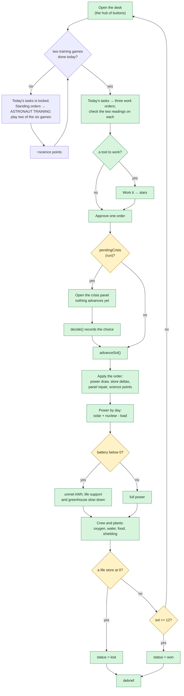
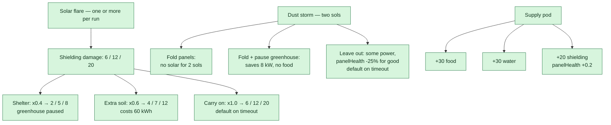
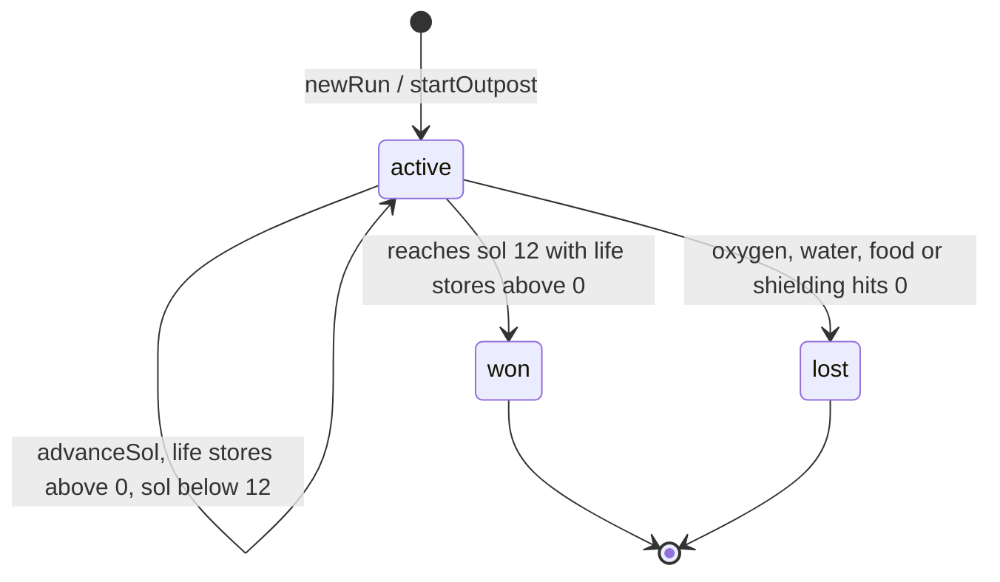

# Game flow and decision map

A single picture of **every decision the game asks the player**, what each answer changes,
and what is actually built. Use it to plan new events without breaking the loop.

Source of truth is the code. Where this file and the code disagree, the code wins — and this
file is wrong. The numbers below were read from `src/sim/` on 2026-11-11.

**Legend**

| Mark | Meaning |
| --- | --- |
| `impl` (green) | Built, wired into the journey, covered by tests |
| `gate` (amber) | A hard stop: the journey cannot continue until this is satisfied |
| `terminal` (blue) | A screen you can leave the loop from |

The run is turn-based: a sol advances only when the player presses the button. The only
timer in the whole game is the 10-second crisis countdown.

> GitHub renders Mermaid in the browser. If a diagram shows **"Unable to render rich
> display"**, reload the page: the renderer occasionally times out before it draws. The
> diagrams are kept small and few on purpose so this stays rare.

---

## 1. The journey, end to end

The landing page still renders behind the journey, but it is no longer a stop: `naming` is the
main menu (D-021) and the default route. `landing` remains a valid deep link (`#/landing`),
and `nextStop('naming')` goes straight to `briefing`.

---

## 2. Every decision, in one table

| # | Decision | Screen | Trigger | Options | If the timer runs out | Stored in `RunState` | Debrief verdict |
| --- | --- | --- | --- | --- | --- | --- | --- |
| D1 | Astronaut name | `naming` | Start Mission | non-empty after trimming; 24 characters max; runs of whitespace collapse | cannot submit empty | `astronautName` | — |
| D2 | Ration packets | `supply` | answer the maths question | four numbers worked out from the question on screen: the answer, plus the three mistakes (forgot the crew, forgot the packet size, forgot both) | must be solved; CONTINUE stays hidden | not stored (the screen is a gate) | — |
| D3 | Landing region | `landing-site` | Land here | Arcadia · Jezero · Olympus · Valles · Argyre | cannot skip | `regionId` | — |
| D4 | Build loadout | `base` | Land &amp; start sol 1 | 8 module kinds, 18 build points, site rules and slot limits | allowed to launch with nothing extra | `modules` | — |
| D5 | Which work order to approve | `act` | each calm sol | the three orders on the desk, each with two readings and possibly a tool | the day still runs; the order is not approved | `chosenActivity`, `inspections` | — |
| D6 | Flare response | `act` | when the forecast rolls a flare | `shelter` · `shield-up` · `carry-on` | `carry-on`, `timedOut = true` | `decisions[]` | `solved` / `caught` |
| D7 | Dust-storm response | `act` | when the forecast rolls a storm | `retract` · `retract-save` · `expose` | `expose`, `timedOut = true` | `decisions[]` | `solved` / `mixed` / `caught` |
| D8 | Supply cargo | `act` | when the forecast rolls a pod | `food` · `water` · `spares` | `food`, `timedOut = true` | `decisions[]` | `mixed` (no special rule) |
| D9 | The rover's find | `act` | when the rover comes back | `log` · `collect` · `leave` | cannot skip; the document waits on the desk | `rover`, `science` | — |

D1–D4 are **pre-run gates**: they shape the starting state. D6–D8 are **in-run crises**:
they are recorded and replayed by the debrief. D5 and D9 are the **desk** — the decisions
that make a sol (D-060).

### The event calendar never doubles up

The forecast's timetable is **rolled per run from a seed** (D-048), so each mission puts its
flares, its storm and its supply pod on different sols — but the rule that governs them
never changes: **two events never happen back to back** (D-056). Each event starts
`MIN_CLEAR_SOLS` sols after the previous one has *ended*, so there is always at least
one quiet sol between any two of them:

| Sol | 1 | 2 | 3 | 4 | 5 | 6 | 7 | 8 | 9 | 10 | 11 | 12 |
| --- | --- | --- | --- | --- | --- | --- | --- | --- | --- | --- | --- | --- |
| Event | | | ☀ flare | | 📦 pod | | 🌪 storm | 🌪 storm | | ☀ flare | | |
| Crisis? | | | yes | | yes | | yes | | | yes | | |
| Desk | pick | pick | — | pick | — | pick | — | pick | pick | — | pick | pick |

That table is **one run's roll**, not the schedule: another seed moves every mark. The rule
is not in the table, it is in the construction — the planner claims the sol on either side of
every event and keeps those sols empty, so no dice roll can break it.

The storm is the only event that lasts more than one sol, and the quiet sol after it is
what keeps it from running straight into the next flare. The sols are *worked out* from the
schedule in `sim/forecast.ts` rather than typed in, so adding a fifth event cannot land
it on top of another one. `forecastIsSpaced(forecast)` is exported so the rule can be
asserted, and `src/sim/forecast.test.ts` does exactly that over 200 seeds.

The other sols are the player's: the desk offers three orders and the player approves one.

---

## 3. Inside `act`: the sol loop

Order matters and is the model: **cargo arrives, the Sun comes up, the night drains the
batteries, and whatever power could not be found slows life support.** Power is deliberately
**not** a life store: a flat battery causes a blackout, and the blackout is what runs oxygen,
water and food down.

### 3a. The five learning goals

Everything in the game is one of five things, and the game says so (D-058). The rules live
in `src/sim/goals.ts`.

**They are the project's learning outcomes, not a score** (D-061). There is deliberately no
target, no counter and no grade: `goalProgress()` reports what the player kept running and
for how long, and the debrief prints it as a record. The way they reach the player is as the
**standing orders** — twenty-four rules, two arriving every sol — written as the five goals in
the order the player meets them.

| Goal | What it is about | The rule that owns it | The player's decision |
| --- | --- | --- | --- |
| **Martian Dust Storm** | Dust cuts the sunlight reaching the solar panels and can affect the equipment | `stormOpacity`, `panelHealth` | Fold the panels away, or leave them out and lose a quarter of their output for good |
| **Life Support** | Keeping oxygen, water and a safe living environment | `oxygenGenerated`, `waterRecycling`, `electrolysisWater` | `air-check`, `recycle-tune`, `dig-ice`, `ice-store` |
| **Radiation Exposure** | Protecting the crew from harmful space radiation | `shieldingChange`, `FLARE_DRAIN` | `shelter`, `shield-up` or `carry-on`; and `stack-shielding`, `mend-suits` |
| **Power Shortage** | Keeping enough electricity for the systems that matter | `extraPowerCost`, the blackout | Every order costs power, and so does every crisis choice |
| **Food Production** | Making sure the crew has food they can count on | `foodGrown`, `GREENHOUSE_FOOD` | `grow-extra`, and building a greenhouse at all |

Each goal carries a NASA fact filed under a topic of its own, so the dust goal never
shows the same fact as the power goal.

### 3b. The day's work orders
Every sol is a **desk** (D-060). On the eight calm sols `act` offers three work orders and
the player approves one; on a crisis sol the crisis replaces the desk, so the crisis *is*
that day's activity. The catalogue and the twelve sol plans live in `src/sim/activities.ts`.

The desk itself is a **hub of buttons** (D-070): today's tasks, the desk, the standing
orders, the colony stats, NASA's real data, and — once a sol has run — the review of the
last sol. Each button carries one line of state, and each opens its section as a sheet
over the desk, so the day is readable at a glance and the player opens only the part they
came for.

### 3a. The day's training
Today's work orders are **locked until the crew has done two training games** (D-075).
The six games — Resource Merge, Memory Match, Rover Parking, Solar Panel Power-Up,
Cargo Sorting and Asteroid Defender — live at the top of the **Standing orders sheet**,
because that is where a rule book lives and the training is now a rule the crew works
to. The lock is on the tile, in a callout on the desk, and in the rules engine itself:
`canStartTraining` refuses a third game and `completeTraining` refuses to pay for a
game twice. Two games a sol, any two of them, and the points are science points on the
one balance the game already has. The day's record is written to `localStorage`, so a
refresh does not hand the player the same two games again; everything else in the run is
still in memory, exactly as it was.

| Step | What happens |
| --- | --- |
| Offer | `offerFor(run, sol)` returns the three orders for that sol, each marked available or locked with the reason |
| Read | each order shows **two readings** to check before it is approved. Looking is the skill, so the readings are on the card, not behind a tap |
| Work | an order with a tool opens a **work-order player** (`ui/activityPlayer.ts`). Working it well wins stars; the stars multiply the order's science and never touch a store (D-063) |
| Approve | the choice is kept on `RunState.chosenActivity`; the stars are kept on `RunState.inspections` |
| Apply | `advanceSol` adds the order's kWh to `extraPowerCost`, its store deltas to the sol's net, and its repair to `panelHealth` |
| Score | the order's science points, times its stars, are added to `RunState.science`, and the sol is recorded on `SolRecord.activity` |

The order's power draw goes through the **same** `extraPowerCost` path as a flare's
shielding digger, so an order competes with life support for the same kWh. Spend 25 kWh
on a rover survey with a flat battery and the sol runs in a blackout.

| Order | Costs | Gives | Science | Locked when |
| --- | --- | --- | --- | --- |
| `rest` | — | — | 3 | never |
| `survey` | 25 kWh | — | 4 | never |
| `experiment` | 15 kWh | — | 6 | never |
| `map-site` | 14 kWh | — | 4 | never |
| `sample-rock` | 10 kWh | — | 4 | never |
| `sweep-panels` | 10 kWh | panel +0.25 | 2 | the panels are already clean |
| `grow-extra` | 8 kWh, 5% water | +6% food | 2 | no greenhouse |
| `dig-ice` | 20 kWh | +6% water | 3 | no ice miner |
| `recycle-tune` | 10 kWh | +3% water | 2 | never |
| `stack-shielding` | 18 kWh | +8% shielding | 3 | never |
| `mend-suits` | 8 kWh | +6% shielding | 2 | never |
| `air-check` | 12 kWh | +6% oxygen | 2 | never |

The best possible run — the best order on each of the eight calm sols, plus the day
logs — scores 52.

**The six tools** live in `src/sim/minigames.ts`, one per engine: `sequence`, `radar`,
`timing`, `sort`, `match` and `pack`. Each is unlocked on its own sol (`ENGINE_UNLOCK_SOL`),
each is graded into **stars**, and each is a pure function over literal inputs.

| Tool | What the player does | Unlocks on |
| --- | --- | --- |
| **Checklist** (`sequence`) | presses the five systems in the order they have to be checked | sol 1 |
| **Timing** (`timing`) | stops the sweeping marker inside the safe band | sol 2 |
| **Radar** (`radar`) | pings squares until one of them is hot | sol 3 |
| **Sorting** (`sort`) | keeps the ones worth keeping and leaves the rest | sol 4 |
| **Matching** (`match`) | gives every tool its job | sol 5 |
| **Packing** (`pack`) | fills the pod within its mass limit | sol 6 |

**Every sol has at least one order the player can work.** The unlock schedule and the sol
plan are two separate lists, and they once drifted apart: sol 3 offered the rover survey,
the site map and the experiment, whose tools were all still locked, so that sol was three
buttons and nothing else (ISS-065). The rule is now checked over the whole plan by
`src/sim/minigames.test.ts`, and it is the rule the schedule is designed around — one new
tool a sol for the first six, and then the whole toolbox.

### 3c. The science score

`RunState.science` totals the points; `src/sim/science.ts` turns the total into a rank.

| Points | Rank |
| --- | --- |
| 0-13 | Explorer |
| 14-27 | Field Scientist |
| 28-40 | Research Lead |
| 41-49 | Senior Scientist |
| 50+ | Chief Martian Scientist |

The bands are set by what a run can actually earn, so a player who chose nothing is still
an Explorer and the top rank is one good run away. **The rank measures the science, not the
outcome:** a run that did a great deal of science and then ran out of water still did the
science. The debrief keeps the two apart — the outcome section explains whether the crew
got home, the score section is about the work.

**Stars multiply the science and nothing else** (D-063). They never give back a kWh, a
litre of water or a gram of food, so the balance of a run cannot depend on how well the
minigames were played. That is what lets `npm run balance` be a straight simulation of the
sol loop with no minigame in it.

---

## 4. How a crisis is presented

| Fact | Value |
| --- | --- |
| Countdown | 10 seconds, flare and storm only; the supply pod has none |
| "Take your time" | Stops the countdown for that crisis |
| Timeout | The default option is applied and `timedOut = true` |
| Earth advice | Shown only if the reply arrives before the problem does |
| Comms delay | `oneWayMinutes(sol) = min(22, 6 + sol)`, so round trip is `2 x that` |

| Crisis | Warning | Round trip | Can Earth answer? |
| --- | --- | --- | --- |
| A flare | 15 min | 18 min | **No** |
| A supply pod | 24 h | 22 min | Yes |
| A dust storm | 10 min | 26 min | **No** |
| A second flare | 15 min | 32 min | **No** |

The fast, dangerous problems are the ones the crew must solve alone. The supply pod is the
one decision there is time to ask about.

The sols these land on are **rolled per run** (D-048), so the table above is the *order*, not
the dates. What is fixed is the delay: the round trip grows as the crew moves further from
Earth, and by sol 12 it is 32 minutes each way — longer than a flare gives warning.

---

## 5. The three crisis decisions

Flare intensity comes from the live flare class: `X = 3`, `M = 2`, `C or below = 1`.

Debrief rules:

- Flare: `shelter` and `shield-up` are `solved`; `carry-on` is `caught`.
- Storm: `retract-save` is `solved`; `retract` is `mixed`; `expose` is `caught`.
- Supply: no special rule, so all three stay `mixed`. Earth's advice is computed from
  days-of-food versus days-of-water, not scripted.

Storm strength depends on the site:
`stormOpacity(dust) = clamp(0.95 - 0.12 x dust, 0.2, 0.95)`. A dust score of 5 still blocks
35%; a dust score of 2 blocks 71%.

---

## 6. What the levers move

| Lever | Improves | Costs |
| --- | --- | --- |
| Solar array | 25 kW while the Sun is up, x site sun x panelHealth x storm factor | 2 points; dust storms cut it |
| Battery bank | 100 kWh of night storage | 2 points; only helps if the panels fill it |
| Nuclear unit | 10 kW day and night, weather-proof | 4 of the 18 build points |
| Greenhouse | 12 food per sol | 8 kW and 3 water per sol |
| Ice miner | water = 3 x site water score | 6 kW; needs a site with water >= 3 |
| Regolith shield | +30 starting shielding each | 2 points; needs terrain >= 2 |
| Life support | 14 oxygen, recycles 90% of water | 8 kW, plus water for electrolysis |
| Crisis choices | stores, panel health, or a paused greenhouse | power, food, water or shielding |
| Stars from a tool | the science an order is worth | nothing. Never a store (D-063) |

The coupling is the game: every module improves one line and loads another. A greenhouse grows
food but costs power and water; a nuclear unit is reliable but eats the build budget.

**The budget is 18, and it is checked.** The game was unwinnable at 14 — no legal build at
any landing site was self-sustaining, and 0 of 3,558 measured runs ended with all five
systems satisfied (ISS-061). `npm run balance` now plays every legal build at every site
over several forecast seeds and **fails** when a site cannot hold all five systems
(D-064). It is the only check that catches this, because a unit test over the constants
only proves they still do what they did.

---

## 7. Run status

Both terminal states route to `debrief`. There is no third state, and losing never costs a
life (R-20).

---

## 8. The five landing regions

| Region | Water | Sun | Terrain | Dust | Temp | Total | Practical effect |
| --- | --- | --- | --- | --- | --- | --- | --- |
| Arcadia Planitia | 5 | 3 | 5 | 3 | 2 | 18 | Most room, most ice; coldest nights |
| Jezero Crater | 4 | 4 | 3 | 3 | 3 | 17 | Balanced, no standout |
| Olympus Mons | 2 | 5 | 2 | 4 | 3 | 16 | Best sun, least room, no ice miner |
| Valles Marineris | 4 | 3 | 2 | 4 | 3 | 16 | Storm-sheltered, cramped ground |
| Argyre Basin | 4 | 3 | 4 | 2 | 4 | 17 | Mildest, but dustiest storms |

Two site rules are hard gates on modules:

- **Ice miner** needs `water >= 3` (rules out Olympus Mons).
- **Regolith shield** needs `terrain >= 2`.

Build room is `terrain + 4` extra modules, and the budget is 18 build points. Every site
totals within 1 of 17/25, so there is no perfect landing spot.

---

## 9. Implementation status

| Area | Status | Where the logic lives | Where the effect is applied |
| --- | --- | --- | --- |
| Name entry | Built | `features/naming/model.ts` | `sim/run.ts` (`astronautName`) |
| Ration gate | Built | `features/supply/model.ts` | view only; no run state |
| Region choice | Built | `sim/regions.ts` | `sim/run.ts` (`landAt`) |
| Module build | Built | `sim/modules.ts`, `features/base/model.ts` | `sim/run.ts` (`startOutpost`) |
| The desk: three work orders | Built | `sim/activities.ts` | `sim/sol.ts` (`advanceSol`), `sim/run.ts` (`chosenActivity`) |
| The two readings on an order | Built | `sim/activities.ts`, `ui/activityPlayer.ts` | view only |
| The six tools and the stars | Built | `sim/minigames.ts` | `sim/run.ts` (`inspections`), `sim/sol.ts` (science × stars) |
| The standing orders | Built | `sim/standingOrders.ts` | `sim/sol.ts` (two new rules a sol); view only |
| The six training games | Built | `sim/training.ts` and six game modules | `sim/run.ts` (`training`), `ui/training.ts` (the section, the dialog, the record) |
| Science score and rank | Built | `sim/science.ts` | `sim/run.ts` (`science`), `features/debrief/model.ts` |
| The five learning goals | Built | `sim/goals.ts` | `sim/standingOrders.ts` (the rules); the debrief prints the record |
| Flare crisis | Built | `sim/crises.ts` | `sim/sol.ts` (`FLARE_DRAIN`, factors) |
| Storm crisis | Built | `sim/crises.ts`, `sim/forecast.ts` | `sim/sol.ts` (`stormFactor`, panel damage) |
| Supply pod | Built | `sim/crises.ts`, `sim/forecast.ts` | `sim/sol.ts` (`SUPPLY_AMOUNT`, spares) |
| Earth advice | Built | `sim/crises.ts`, `sim/comms.ts` | view only |
| The rover | Built | `sim/rover.ts` (rules **and** catalogue) | `sim/run.ts` (`rover`), `sim/sol.ts` (deploys it) |
| The notes on the desk | Built | `sim/deskNotes.ts` | view only |
| The patches a run earns | Built | `sim/patches.ts` | `features/debrief/view.ts` |
| The how-to-play guide | Built | `sim/guide.ts` | `ui/guide.ts`, the header's `?` icon button; a popup with the astronaut and a speech bubble, one step per page (D-073) |
| The desk as a hub of buttons | Built | `features/act/model.ts` (`hubTiles`) | `features/act/view.ts`; each button opens a `ui/sheet.ts` section (D-070) |
| The balance | **Checked** | `sim/modules.ts` | `npm run balance` — fails if a site cannot hold all five systems |
| Live NASA daily pictures | Built | `data/nasaDaily.ts` | `features/act/view.ts`, `ui/nasaFeedCard.ts` |
| Debrief verdicts | Built | `features/debrief/model.ts` | read only |
| Save / resume | Built | `sim/save.ts`, `ui/save.ts` | the menu greets the astronaut by name, CONTINUE returns to the screen they left, START OVER clears it; one device-local `localStorage` key (D-081) |
| Login before `naming` | **Not built** | — | D-003, TASK-022 |
| Planning phase | **Not built** | — | D-029: do not add unasked |
| Procedural work orders | **Deliberately not built** | — | D-060: the orders are a curriculum, not a random draw |
| New forecast events | **Not built** | — | this file, §10 |

### The NASA layer

Three things in this game come from NASA, and they behave differently on purpose.

**Space weather.** The forecast's timetable is rolled per run (D-048) and the *size* of
each flare comes from live data: NASA DONKI first, then NOAA SWPC, then the long-run
record of real M and X flares when neither answers. `data/spaceweather.ts` is the only
place allowed to make that request. The act screen's **Real data** sheet shows NASA's own
readings — the flare class and the day it peaked, strongest first, with the source they
came from — and not only the game's timetable (D-071).

**The daily picture.** Every sol also carries a real NASA picture and its written
explanation, read live from the Astronomy Picture of the Day, filtered to Mars
(D-053). `data/nasaDaily.ts` is the only place allowed to make *that* request.

**The rover's finds.** The seven places and rocks the rover turns up are a fixed,
checked list of real NASA pictures in `src/sim/rover.ts` — Viking 1, Sojourner,
Beagle 2, Schiaparelli, Heat Shield Rock, Block Island and the leopard-spot rock. The
browser fetches the picture itself; there is no search and no API call, so a slow
connection or an outage cannot cost the player a lesson. A picture that fails to load
is dropped and the words stay.

The catalogue lives in `sim/` and not `data/` because the simulation now owns the rover's
whole lifecycle: it is sent out by a work order, it drives on **sol time**, and it comes
back with a document on the desk (D-062). `data/` is for things fetched from a network.

The daily picture is an **enrichment layer on top of** a saved gallery of twelve checked
NASA cards, never a replacement. When NASA is busy, slow or offline, the saved card stays
on screen and the game says why. That is the same rule the space-weather chain follows,
and for the same reason: **the game is complete without a network**, and the player is
never shown a number or a picture whose source cannot be named.

Beside them, forty short NASA facts are filed under six topics — power, dust, water,
food, radiation and missions — and one topic per science goal. That is what lets the
act screen put the fact about water next to the activity that touches water, and the
fact about radiation next to the one that piles soil on the habitat.

**Where the layer is shown.** The act screen's *Real data* sheet is where all of it lives
(D-071): NASA's live daily picture, the saved card for the sol, the **landing region's own
photograph**, NASA's own space-weather readings, and two facts to take away. The region's
photograph used to appear once on the landing screen and never again; the flare readings
used to be thrown away by the loader, leaving only the game's timetable.

---

## 10. Adding a new event

The forecast's timetable is rolled per run (D-048); adding a new event *kind* touches
six places, in this order. Nothing here needs a network call; only flare *size* is live.

| Step | File | What to add |
| --- | --- | --- |
| 1 | `src/sim/forecast.ts` | A `ForecastKind` member, a branch in `planEvents()` and a warning window in `WARNING_SOLS`, plus a builder in `createForecast()` |
| 2 | `src/sim/run.ts` | The `SolEvent['kind']` union member, so the timeline and debrief accept it |
| 3 | `src/sim/crises.ts` | A branch in `crisisForEvent()`: title, prompt, `urgent`, `countdownSeconds`, `windowMinutes`, `options`, `defaultOptionId`, `science` |
| 4 | `src/sim/sol.ts` | Read `chosen(run, event.id)` in the `eventsStartingOn` loop and change `net`, `panelHealth` or `greenhousePaused` |
| 5 | `src/features/debrief/model.ts` | A `crisis.kind === ...` verdict block in `reviewDecisions()` |
| 6 | tests + docs | Pin the option ids and store deltas; record the choice in `docs/team/decisions.md`, including the **Rejected** line |

Event patterns you can copy:

| Pattern | Copy from | Effect shape |
| --- | --- | --- |
| Timed choice that damages shielding | flare, `sim/sol.ts` | `shieldingChange -= base * factor` |
| Timed choice that trades power for safety | storm, `sim/sol.ts` | `stormFactor`, `greenhousePaused` |
| Untimed choice that adds stores | supply pod, `sim/sol.ts` | `foodChange += ...`, `waterChange += ...` |
| Choice that repairs hardware | supply spares | `panelHealth = min(1, panelHealth + 0.2)` |
| Choice that costs battery | flare `shield-up` | `extraPowerCost += 60` |

Planned ideas, none of them built:

| Idea | Kind | Decision it creates | Files it would touch | Cost |
| --- | --- | --- | --- | --- |
| Communications blackout | new | Spend power to retry, or wait a sol | `forecast.ts`, `crises.ts`, `sol.ts` | Small |
| Micrometeorite hit | new | Patch the hull now, or seal a room | `crises.ts`, `sol.ts` | Medium |
| Crew illness | new | Ration medicine, or isolate and lose a worker | `crises.ts`, `sol.ts` | Medium |
| Ice miner breakdown | reuse supply shape | Repair, or run on stored water | `forecast.ts`, `crises.ts` | Small |
| Second supply pod | reuse supply shape | Two cargo choices in one run | `forecast.ts` only | Very small |
| Warning-window solar storm | reuse flare + comms | Act now, or wait for a better forecast | `crises.ts`, `comms.ts` | Medium |

Before any of these: log it in `docs/team/tasks.md`, and record the design choice in
`docs/team/decisions.md`. A new event changes the balance, so update the acceptance tests too.

---

## 11. Adding a new work order

A work order is a choice inside a sol, not a forecast event (D-051, D-060). Adding one
touches four places, in this order.

| Step | File | What to add |
| --- | --- | --- |
| 1 | `src/sim/activities.ts` | An `ActivitySpec` in `ACTIVITY_CATALOGUE`: the cost, the gain, the science points, the topic, and any `requires` gate with its reason |
| 2 | `src/sim/activities.ts` | The order's id in one sol plan's `activityIds`, if it should be offered that day |
| 3 | tests | Pin the catalogue's integrity: unique ids, a known topic, at least one available option on every sol, and the exact store deltas |
| 4 | docs | The order in `docs/game-flow.md` §3b and in `docs/architecture.md`; record the choice in `docs/team/decisions.md` if it changes the rules |

The sim applies the order already: `advanceSol` reads `RunState.chosenActivity` and
applies `powerCostKwh`, `storeDelta` and `panelRepair`. A new kind of effect needs a new
field on `ActivitySpec` and one more line in `sim/sol.ts`.

**A new tool** is a new engine in `src/sim/minigames.ts`: a `grade*` function that takes
literal inputs and returns a `Grade`, an entry in `ENGINE_UNLOCK_SOL` and one in
`ENGINE_NAME`, and a player in `src/ui/activityPlayer.ts` that drives it. The rule that
matters: **stars multiply science and touch no store** (D-063).

The other rule that matters: **the unlock schedule has to leave every sol with at least one
order the player can work.** Check that before you add an engine or change a sol plan —
`src/sim/minigames.test.ts` says so over the whole plan, and it will tell you which sol
broke (ISS-065).

Keep the costs honest. An order that gives more for less than another one on the same
sol makes the other one pointless — that is how `ice-store` was removed in favour of
`sample-rock`.

---

## 12. What is deliberately absent

| Thing | Why | Where it is recorded |
| --- | --- | --- |
| A planning phase | The loop is turn-based on purpose | D-029 |
| A real save: accounts, cross-device | The run is written to this browser only; Supabase deferred | D-003, D-081 |
| Login before `naming` | Same deferral | D-003, TASK-022 |
| Procedural work orders | The orders are a curriculum; randomising them breaks the teaching | D-060 |
| A score for the five goals | They are the learning outcomes, not a second win condition | D-061 |
| Stars that give resources | The balance must not depend on how well a minigame was played | D-063 |
| Multiplayer, leaderboards, telemetry | No backend | AGENTS.md §10 |
| Runtime dependencies | Zero today; adding one is an architecture change | AGENTS.md §10 |

If a new event needs any of these, stop and get the decision recorded first.

---

## 13. Where to look next

| Question | File |
| --- | --- |
| Every tuning number | `src/sim/modules.ts` |
| The day's work orders | `src/sim/activities.ts` |
| The rules the player works to | `src/sim/standingOrders.ts` |
| The six tools, and how each is graded | `src/sim/minigames.ts` |
| The how-to-play guide | `src/sim/guide.ts` |
| The rover's rules and its catalogue | `src/sim/rover.ts` |
| Event schedule and flare intensity | `src/sim/forecast.ts` |
| Crisis copy, options, defaults, Earth advice | `src/sim/crises.ts` |
| Sol resolution order | `src/sim/sol.ts` |
| Run state shape | `src/sim/run.ts` |
| Region trade-offs | `src/sim/regions.ts` |
| Why a decision was scored the way it was | `src/features/debrief/model.ts` |
| Is the game still winnable? | `npm run balance` — `tools/balance-check.mts` |
| Architecture and module contracts | `docs/architecture.md` |
| Decisions and rejected alternatives | `docs/team/decisions.md` |
