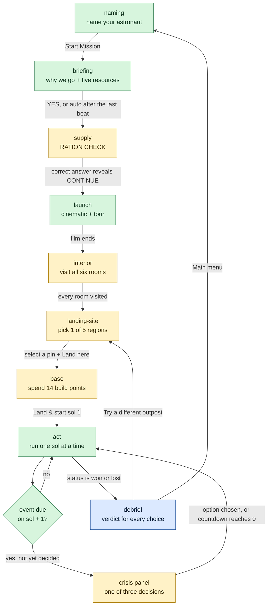
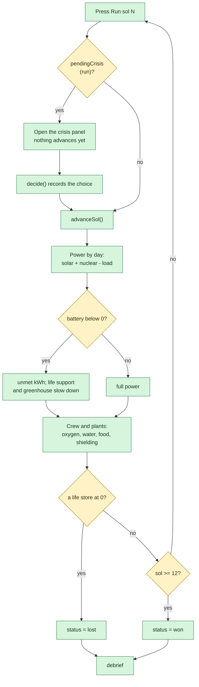
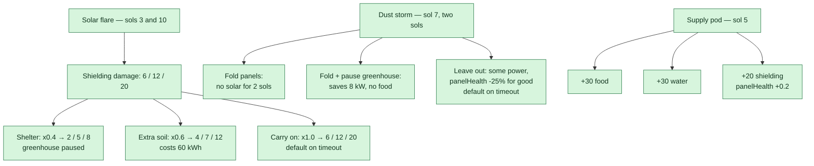
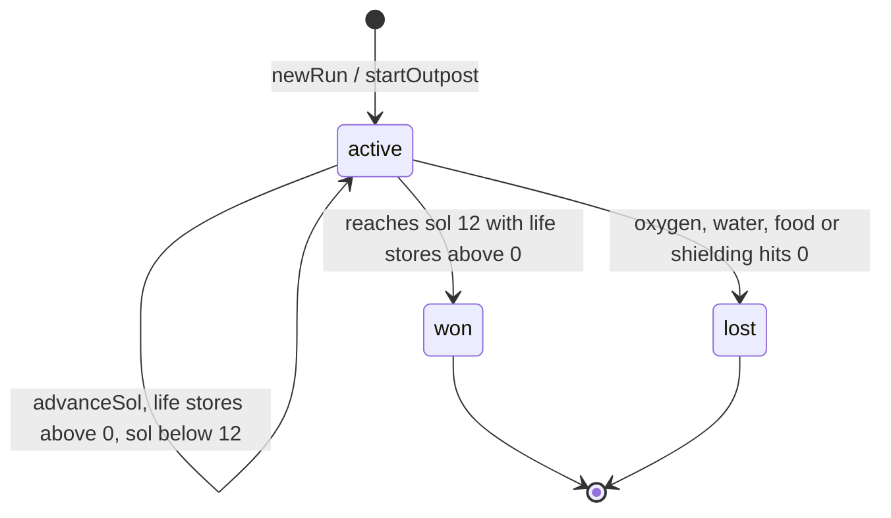

# Game flow and decision map

A single picture of **every decision the game asks the player**, what each answer changes,
and what is actually built. Use it to plan new events without breaking the loop.

Source of truth is the code. Where this file and the code disagree, the code wins — and this
file is wrong. The numbers below were read from `src/sim/` on 2026-11-10.

**Legend**

| Mark | Meaning |
| --- | --- |
| `impl` (green) | Built, wired into the journey, covered by tests |
| `gate` (amber) | A hard stop: the journey cannot continue until this is satisfied |
| `terminal` (blue) | A screen you can leave the loop from |

The run is turn-based: a sol advances only when the player presses the button. The only
timer in the whole game is the 10-second crisis countdown.

> GitHub renders Mermaid in the browser. If a diagram shows **"Unable to render rich
> display"**, reload the page: the renderer occasionally times out before it draws. The
> diagrams are kept small and few on purpose so this stays rare.

---

## 1. The journey, end to end

The landing page still renders behind the journey, but it is no longer a stop: `naming` is the
main menu (D-021) and the default route. `landing` remains a valid deep link (`#/landing`),
and `nextStop('naming')` goes straight to `briefing`.

---

## 2. Every decision, in one table

| # | Decision | Screen | Trigger | Options | If the timer runs out | Stored in `RunState` | Debrief verdict |
| --- | --- | --- | --- | --- | --- | --- | --- |
| D1 | Astronaut name | `naming` | Start Mission | non-empty after trimming; 24 characters max; runs of whitespace collapse | cannot submit empty | `astronautName` | — |
| D2 | Ration packets | `supply` | answer the maths question | 20 · **80** · 240 · 720 | must be solved; CONTINUE stays hidden | not stored (the screen is a gate) | — |
| D3 | Landing region | `landing-site` | Land here | Arcadia · Jezero · Olympus · Valles · Argyre | cannot skip | `regionId` | — |
| D4 | Build loadout | `base` | Land &amp; start sol 1 | 8 module kinds, 14 build points, site rules and slot limits | allowed to launch with nothing extra | `modules` | — |
| D5 | Flare response | `act` | sol 3 and sol 10 | `shelter` · `shield-up` · `carry-on` | `carry-on`, `timedOut = true` | `decisions[]` | `solved` / `caught` |
| D6 | Dust-storm response | `act` | sol 7 | `retract` · `retract-save` · `expose` | `expose`, `timedOut = true` | `decisions[]` | `solved` / `mixed` / `caught` |
| D7 | Supply cargo | `act` | sol 5 | `food` · `water` · `spares` | `food`, `timedOut = true` | `decisions[]` | `mixed` (no special rule) |

D1–D4 are **pre-run gates**: they shape the starting state. D5–D7 are **in-run crises**: they
are recorded and replayed by the debrief.

---

## 3. Inside `act`: the sol loop

Order matters and is the model: **cargo arrives, the Sun comes up, the night drains the
batteries, and whatever power could not be found slows life support.** Power is deliberately
**not** a life store: a flat battery causes a blackout, and the blackout is what runs oxygen,
water and food down.

---

## 4. How a crisis is presented

| Fact | Value |
| --- | --- |
| Countdown | 10 seconds, flare and storm only; the supply pod has none |
| "Take your time" | Stops the countdown for that crisis |
| Timeout | The default option is applied and `timedOut = true` |
| Earth advice | Shown only if the reply arrives before the problem does |
| Comms delay | `oneWayMinutes(sol) = min(22, 6 + sol)`, so round trip is `2 x that` |

| Crisis | Window | Round trip | Can Earth answer? |
| --- | --- | --- | --- |
| Flare on sol 3 | 15 min | 18 min | **No** |
| Supply pod on sol 5 | 24 h | 22 min | Yes |
| Storm on sol 7 | 10 min | 26 min | **No** |
| Flare on sol 10 | 15 min | 32 min | **No** |

The fast, dangerous problems are the ones the crew must solve alone. The supply pod is the
one decision there is time to ask about.

---

## 5. The three crisis decisions

Flare intensity comes from the live flare class: `X = 3`, `M = 2`, `C or below = 1`.

Debrief rules:

- Flare: `shelter` and `shield-up` are `solved`; `carry-on` is `caught`.
- Storm: `retract-save` is `solved`; `retract` is `mixed`; `expose` is `caught`.
- Supply: no special rule, so all three stay `mixed`. Earth's advice is computed from
  days-of-food versus days-of-water, not scripted.

Storm strength depends on the site:
`stormOpacity(dust) = clamp(0.95 - 0.12 x dust, 0.2, 0.95)`. A dust score of 5 still blocks
35%; a dust score of 2 blocks 71%.

---

## 6. What the levers move

| Lever | Improves | Costs |
| --- | --- | --- |
| Solar array | 25 kW while the Sun is up, x site sun x panelHealth x storm factor | 2 points; dust storms cut it |
| Battery bank | 100 kWh of night storage | 2 points; only helps if the panels fill it |
| Nuclear unit | 10 kW day and night, weather-proof | 4 of the 14 build points |
| Greenhouse | 12 food per sol | 8 kW and 5 water per sol |
| Ice miner | water = 3 x site water score | 6 kW; needs a site with water >= 3 |
| Regolith shield | +30 starting shielding each | 2 points; needs terrain >= 2 |
| Life support | 14 oxygen, recycles 90% of water | 8 kW, plus water for electrolysis |
| Crisis choices | stores, panel health, or a paused greenhouse | power, food, water or shielding |

The coupling is the game: every module improves one line and loads another. A greenhouse grows
food but costs power and water; a nuclear unit is reliable but eats the build budget.

---

## 7. Run status

Both terminal states route to `debrief`. There is no third state, and losing never costs a
life (R-20).

---

## 8. The five landing regions

| Region | Water | Sun | Terrain | Dust | Temp | Total | Practical effect |
| --- | --- | --- | --- | --- | --- | --- | --- |
| Arcadia Planitia | 5 | 3 | 5 | 3 | 2 | 18 | Most room, most ice; coldest nights |
| Jezero Crater | 4 | 4 | 3 | 3 | 3 | 17 | Balanced, no standout |
| Olympus Mons | 2 | 5 | 2 | 4 | 3 | 16 | Best sun, least room, no ice miner |
| Valles Marineris | 4 | 3 | 2 | 4 | 3 | 16 | Storm-sheltered, cramped ground |
| Argyre Basin | 4 | 3 | 4 | 2 | 4 | 17 | Mildest, but dustiest storms |

Two site rules are hard gates on modules:

- **Ice miner** needs `water >= 3` (rules out Olympus Mons).
- **Regolith shield** needs `terrain >= 2`.

Build room is `terrain + 3` extra modules. Every site totals within 1 of 17/25, so there is
no perfect landing spot.

---

## 9. Implementation status

| Area | Status | Where the logic lives | Where the effect is applied |
| --- | --- | --- | --- |
| Name entry | Built | `features/naming/model.ts` | `sim/run.ts` (`astronautName`) |
| Ration gate | Built | `features/supply/model.ts` | view only; no run state |
| Region choice | Built | `sim/regions.ts` | `sim/run.ts` (`landAt`) |
| Module build | Built | `sim/modules.ts`, `features/base/model.ts` | `sim/run.ts` (`startOutpost`) |
| Flare crisis | Built | `sim/crises.ts` | `sim/sol.ts` (`FLARE_DRAIN`, factors) |
| Storm crisis | Built | `sim/crises.ts`, `sim/forecast.ts` | `sim/sol.ts` (`stormFactor`, panel damage) |
| Supply pod | Built | `sim/crises.ts`, `sim/forecast.ts` | `sim/sol.ts` (`SUPPLY_AMOUNT`, spares) |
| Earth advice | Built | `sim/crises.ts`, `sim/comms.ts` | view only |
| Debrief verdicts | Built | `features/debrief/model.ts` | read only |
| Save / resume | **Not built** | — | D-003: run is memory only |
| Login before `naming` | **Not built** | — | D-003, TASK-022 |
| Planning phase | **Not built** | — | D-029: do not add unasked |
| New forecast events | **Not built** | — | this file, §10 |

---

## 10. Adding a new event

The forecast's timetable is rolled per run (D-048); adding a new event *kind* touches
six places, in this order. Nothing here needs a network call; only flare *size* is live.

| Step | File | What to add |
| --- | --- | --- |
| 1 | `src/sim/forecast.ts` | A `ForecastKind` member, a branch in `planEvents()` and a warning window in `WARNING_SOLS`, plus a builder in `createForecast()` |
| 2 | `src/sim/run.ts` | The `SolEvent['kind']` union member, so the timeline and debrief accept it |
| 3 | `src/sim/crises.ts` | A branch in `crisisForEvent()`: title, prompt, `urgent`, `countdownSeconds`, `windowMinutes`, `options`, `defaultOptionId`, `science` |
| 4 | `src/sim/sol.ts` | Read `chosen(run, event.id)` in the `eventsStartingOn` loop and change `net`, `panelHealth` or `greenhousePaused` |
| 5 | `src/features/debrief/model.ts` | A `crisis.kind === ...` verdict block in `reviewDecisions()` |
| 6 | tests + docs | Pin the option ids and store deltas; record the choice in `docs/team/decisions.md`, including the **Rejected** line |

Event patterns you can copy:

| Pattern | Copy from | Effect shape |
| --- | --- | --- |
| Timed choice that damages shielding | flare, `sim/sol.ts` | `shieldingChange -= base * factor` |
| Timed choice that trades power for safety | storm, `sim/sol.ts` | `stormFactor`, `greenhousePaused` |
| Untimed choice that adds stores | supply pod, `sim/sol.ts` | `foodChange += ...`, `waterChange += ...` |
| Choice that repairs hardware | supply spares | `panelHealth = min(1, panelHealth + 0.2)` |
| Choice that costs battery | flare `shield-up` | `extraPowerCost += 60` |

Planned ideas, none of them built:

| Idea | Kind | Decision it creates | Files it would touch | Cost |
| --- | --- | --- | --- | --- |
| Communications blackout | new | Spend power to retry, or wait a sol | `forecast.ts`, `crises.ts`, `sol.ts` | Small |
| Micrometeorite hit | new | Patch the hull now, or seal a room | `crises.ts`, `sol.ts` | Medium |
| Crew illness | new | Ration medicine, or isolate and lose a worker | `crises.ts`, `sol.ts` | Medium |
| Ice miner breakdown | reuse supply shape | Repair, or run on stored water | `forecast.ts`, `crises.ts` | Small |
| Second supply pod | reuse supply shape | Two cargo choices in one run | `forecast.ts` only | Very small |
| Warning-window solar storm | reuse flare + comms | Act now, or wait for a better forecast | `crises.ts`, `comms.ts` | Medium |

Before any of these: log it in `docs/team/tasks.md`, and record the design choice in
`docs/team/decisions.md`. A new event changes the balance, so update the acceptance tests too.

---

## 11. What is deliberately absent

| Thing | Why | Where it is recorded |
| --- | --- | --- |
| A planning phase | The loop is turn-based on purpose | D-029 |
| Save / resume | No persistence; Supabase deferred | D-003 |
| Login before `naming` | Same deferral | D-003, TASK-022 |
| Persisting the astronaut name | A deliberate decision, not a convenience | D-003 |
| Multiplayer, leaderboards, telemetry | No backend | AGENTS.md §10 |
| Runtime dependencies | Zero today; adding one is an architecture change | AGENTS.md §10 |

If a new event needs any of these, stop and get the decision recorded first.

---

## 12. Where to look next

| Question | File |
| --- | --- |
| Every tuning number | `src/sim/modules.ts` |
| Event schedule and flare intensity | `src/sim/forecast.ts` |
| Crisis copy, options, defaults, Earth advice | `src/sim/crises.ts` |
| Sol resolution order | `src/sim/sol.ts` |
| Run state shape | `src/sim/run.ts` |
| Region trade-offs | `src/sim/regions.ts` |
| Why a decision was scored the way it was | `src/features/debrief/model.ts` |
| Architecture and module contracts | `docs/architecture.md` |
| Decisions and rejected alternatives | `docs/team/decisions.md` |
